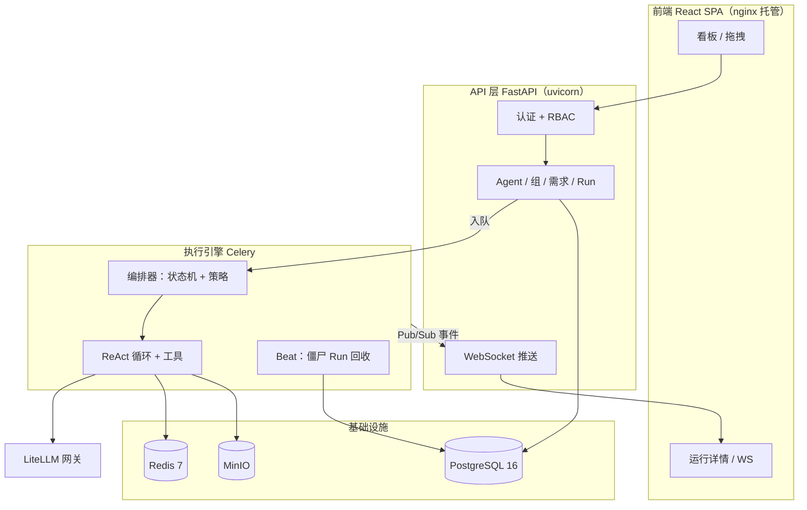

# Agent 工作台（Multi-Agent Workspace）

[](https://github.com/HangChi/multi-agent-workspace/actions/workflows/ci.yml)

> 拖拽式任务分发 + 多角色 Agent 执行的工作台系统。

把需求写成卡片，拖到某个 Agent 或 Agent 组上，系统就开始编排执行：状态机推进、逐步调用工具、
全程 WebSocket 实时可见，产出结果与制品。适合部署在自己的服务器上，团队/个人自用。

---

## 核心能力

| 能力 | 说明 |
|---|---|
| **拖拽分配** | 需求卡片用 dnd-kit 拖到 Agent 卡或组卡，落点弹窗选策略，`POST /requests/{id}/assign` 毫秒级受理，重活交给 Celery |
| **四种编排策略** | `direct` 单 Agent · `fan_out` 并行分发 · `pipeline` 顺序串联 · `router` 模型选成员，父子 Run 通过 `parent_run_id` 关联 |
| **ReAct 执行引擎** | 自研状态机 + 工具循环：LLM 推理 → 工具调用 → 结果回填 → 直到出最终答案；每步落库，可展开查看输入输出 |
| **实时反馈** | WebSocket 推送状态流转、分步日志、成本累计；支持心跳保活与终态自动关闭 |
| **成本熔断** | 单 Agent 成本上限 + 每用户月配额，超限自动终止并给出可读原因 |
| **人工介入** | Agent 需要补充信息时进入 `needs_input`，用户回复后从断点继续 |
| **可观测** | 请求级 `request_id` 贯穿 API 与 Worker，生产环境结构化 JSON 日志 + 字段自动脱敏 |
| **安全** | 三角色 RBAC（admin/member/viewer）、资源归属校验、敏感操作审计日志、生产环境弱密钥启动熔断 |

## 页面

| 路由 | 页面 | 内容 |
|---|---|---|
| `/` | 看板 | 需求按状态分列、拖拽源、Agent/组作为投放目标 |
| `/dashboard` | 仪表盘 | 运行中/排队数、今日完成与失败、7 日成功率与成本趋势 |
| `/agents` | Agent 管理 | 名称、描述、系统提示词、模型、温度、最大步数、工具集、成本上限 |
| `/groups` | Agent 组 | 成员增删排序 + 默认路由策略 |
| `/runs/:runId` | 运行详情 | 状态时间线、分步日志、成本、制品下载、取消/重试/回复 |
| `/admin` | 管理后台 | 审计日志（仅 admin，前端有角色守卫 + 后端 403 双保险） |

---

## 快速开始

### A. 全栈 Docker（推荐）

```bash
cp deploy/.env.example deploy/.env    # 生产必改 JWT_SECRET / INVITE_CODE / LLM_API_KEY
docker compose -p aw -f deploy/docker-compose.yml up -d --build
```

打开 <http://localhost:8080>。

> 项目名必须固定为 `aw`，容器名是 `aw-*`；不加 `-p aw` 会按目录名推导项目名导致容器名冲突。
> `.env` 必须放在 `deploy/` 下。

**没有真实 LLM 密钥也能跑通全链路**：改用 `--profile mock` 拉起内置 Mock 网关，并把
`deploy/.env` 的 `LLM_BASE_URL` 设为 `http://llm-gateway:4000`。

```bash
docker compose -p aw -f deploy/docker-compose.yml --profile mock up -d --build
```

### B. 本地开发（前后端热更新）

```bash
# 1. 只起基础设施
docker compose -p aw -f deploy/docker-compose.yml up -d postgres redis minio

# 2. 后端（Python 3.12+）
cd backend
python -m venv .venv && source .venv/bin/activate
pip install -e ".[dev]"
alembic upgrade head
uvicorn app.main:app --reload --port 8000

# 3. 前端（Node 22+）
cd frontend
npm install
npm run dev        # http://127.0.0.1:5173，/api 与 /ws 代理到 127.0.0.1:8000
```

### C. 创建第一个管理员

系统没有开放注册，必须凭邀请码。首个 admin 用脚本创建：

```bash
cd backend
python scripts/bootstrap.py \
  --email admin@example.com --password 'StrongPassw0rd!' \
  --invite-code ADMIN-CODE-123 --invite-role member --invite-max-uses 10
```

脚本会建/更新 admin 用户，并生成一个 `member` 角色的邀请码，供其他成员注册。API 文档见
<http://localhost:8000/docs>（FastAPI 自动生成 OpenAPI）。

---

## 架构



**分层取舍**：API 层只做校验 + 写入 + 入队 + 发事件，保证分配接口快速返回；重活全在 Worker。
Redis 同时承担队列、事件 Pub/Sub、分布式锁与 refresh token 存储。详见
[docs/architecture.md](docs/architecture.md)。

### 执行状态机

```
created → assigned → queued → running → completed
                                  ├──→ failed ──→ retry
                                  ├──→ needs_input ──→ running
                                  └──→ cancelled / timeout
```

`completed` 是终态，不允许回退到 `running`；重复执行由 Redis 锁 + `run_id` 唯一约束拦住。

### 编排策略

| 策略 | 语义 | 产物 |
|---|---|---|
| `direct` | 直接指定单个 Agent | 1 个 Run |
| `fan_out` | 组内成员并行执行同一需求 | 父 Run + N 个子 Run |
| `pipeline` | 按 `position` 顺序串联，前一段产出作为后一段输入 | 父 Run + N 个顺序子 Run（`runs.sequence` 排序） |
| `router` | LLM 按需求内容选最合适的成员 | 父 Run 自执行，决策写入 `result.routing`，路由成本计入 Run |

`pipeline` 只入队第一阶段，父 Run 不直接入队（否则会立刻"完成"）；某段失败会取消剩余段并把父 Run 标 failed。
`router` 解析或调用失败时全部降级到第一个成员，不会让需求卡死。

---

## 目录结构

```
backend/
  app/
    api/v1/         # 路由：auth/agents/groups/requests/runs/ws/stats/admin
    core/           # 配置、DB、JWT、token 存储、日志、审计
    models/         # SQLAlchemy 模型
    schemas/        # Pydantic v2 模型
    services/       # 业务逻辑：分配、配额、统计、僵尸回收
    orchestrator/   # state_machine / strategies / runner / router
    executors/      # 工具执行器：calculate / read_url / web_search
    tasks/          # Celery 任务与 Beat 调度
  alembic/          # 数据库迁移
  tests/            # unit + integration
  scripts/          # bootstrap 引导脚本
frontend/
  src/
    api/            # axios 客户端 + 全部端点封装
    components/     # ui 基础组件 / board / agent / run / layout
    pages/          # 看板 / 仪表盘 / Agent / 组 / 运行详情 / 管理
    stores/         # Zustand：auth / theme / board
    hooks/          # useAuth / useRequests / useRunSocket
deploy/             # docker-compose / Caddyfile / .env.example / mock-llm / verify
docs/               # 架构文档
specs/              # Spec Kit 规格（SDD + TDD 工作流）
```

---

## API 概览

所有接口前缀 `/api/v1`，除注册/登录外均需 `Authorization: Bearer <access_token>`。

```
POST   /auth/register                      邀请码注册（自动登录）
POST   /auth/login                         邮箱 + 密码 → access + refresh
POST   /auth/refresh                       refresh 轮换（带宽限期）
GET    /auth/me                            当前用户

GET|POST      /agents                      列表（?status=&q=）/ 创建
PATCH|DELETE  /agents/{id}                 编辑 / 删除（被组引用时 409，只能归档）
POST          /agents/{id}/archive         归档

GET|POST      /groups                      Agent 组
PATCH|DELETE  /groups/{id}
POST          /groups/{id}/members         添加成员
PATCH         /groups/{id}/members         批量改顺序
DELETE        /groups/{id}/members/{aid}   移除成员

GET|POST      /requests                    看板列表（?status=&q=&priority=&page=）/ 创建
GET           /requests/{id}
POST          /requests/{id}/attachments   附件上传（预签名）
POST          /requests/{id}/assign        拖拽落点：{assignee_type, assignee_id, strategy?}

GET           /runs/{id}                   详情（状态、步骤、成本、错误）
POST          /runs/{id}/cancel            取消
POST          /runs/{id}/retry             重试
POST          /runs/{id}/reply             补充信息后继续
GET           /runs/{id}/artifacts/{aid}   制品下载（302 → 预签名 URL）

WS            /ws/runs/{id}?token=...      实时状态 + 分步日志 + 成本
GET           /stats/overview              仪表盘聚合（运行中/排队/今日完成失败/7 日成功率与成本）
GET           /audit-logs                  审计日志（仅 admin，支持分页与筛选）
GET           /health, /health/ready       存活 / 就绪探针
```

**认证细节**：access token 默认 30 分钟，refresh 一次性消费（真轮换，旧 token 立即失效）；
`REFRESH_GRACE_SECONDS` 给多标签页并发刷新留宽限期，避免互相踢下线。

### 内置工具

Agent 可挂载的工具由执行器注册表提供，当前实现 3 个：

| 工具 | 说明 |
|---|---|
| `web_search` | 联网搜索，需配置 `SEARCH_API_URL` / `SEARCH_API_KEY`，未配置时返回可读降级结果 |
| `read_url` | 抓取网页正文，带 SSRF 防护：私网 IP 拦截、重定向逐跳校验、2MB 上限 |
| `calculate` | 四则运算，AST 白名单求值（禁 `eval`，限制幂指数防计算爆炸） |

---

## 配置

全部配置走环境变量，`deploy/.env.example` 是完整清单。关键项：

| 变量 | 默认 | 说明 |
|---|---|---|
| `APP_ENV` | `development` | 设为 `production` 时启动强校验 `JWT_SECRET`(≥32) 与 `INVITE_CODE`(≥12)，弱密钥直接拒绝启动 |
| `DATABASE_URL` | `postgresql+asyncpg://...` | PostgreSQL 连接串 |
| `REDIS_URL` / `CELERY_BROKER_URL` / `CELERY_RESULT_BACKEND` | `redis://localhost:6379/{0,1,2}` | 缓存/队列/结果后端分库 |
| `JWT_SECRET` | — | 生产必改 |
| `JWT_ACCESS_TTL_MINUTES` | `30` | access token 时长 |
| `JWT_REFRESH_TTL_DAYS` | `7` | refresh token 时长 |
| `REFRESH_GRACE_SECONDS` | `30` | refresh 宽限期，`0` = 严格一次性 |
| `INVITE_CODE` | — | 首个管理员邀请码 |
| `LLM_API_KEY` / `LLM_MODEL` / `LLM_BASE_URL` | `gpt-4o-mini` / OpenAI | 走 LiteLLM 网关，任意 OpenAI 兼容端点 |
| `MINIO_*` | `localhost:9000` | 附件与制品存储（S3 兼容） |
| `MONTHLY_QUOTA_CENTS` | `1000000` | 每用户月成本上限（分），用尽后新分配返回 429 |
| `CORS_ORIGINS` | `http://localhost:5173` | 本地开发前端地址 |

---

## 测试与质量门禁

CI（[.github/workflows/ci.yml](.github/workflows/ci.yml)）在每次 push / PR 跑以下流水线：

- **后端**：`ruff check` → `ruff format --check` → `mypy app` → `alembic upgrade head`
  （空库可达性）→ `pytest --cov`（带覆盖率门禁）
  （Postgres 16 + Redis 7 service，MinIO 用 `docker run` 起，因为 service 不允许自定义启动命令）
- **前端**：`eslint` → `prettier --check` → `tsc --noEmit` → `vitest run` → `vite build`
  （并断言 CSS 产物 > 5KB，专防 PostCSS/Tailwind 配置丢失导致整站零样式回归）
- **镜像**：`docker build backend` → 起容器 → 容器内自请求 `/openapi.json` 探活 → 断言非 root

三道门禁解决的是同一类问题：**代码没问题、但交付物坏了**。

- `ruff format --check` / `prettier --check`：没有它，格式会随各自编辑器的保存钩子漂移，
  最终每次 diff 都夹带无关改动。`ruff check` 只看语义，不管排版，两者必须都有。
- 覆盖率门禁（阈值见 `backend/pytest.ini` 的 `fail_under`）：没有它，删测试不会有任何反馈，
  覆盖率只会单向下降。
- 镜像构建 + 启动探活：没有它，`Dockerfile` 可以长期失修而 CI 全绿 ——
  依赖清单改了忘同步 lock、基础镜像 tag 消失，都要拖到部署当天才发现。

本地等价命令：

```bash
# 后端（测试库需先建：createdb agent_workbench_test）
cd backend
DATABASE_URL="postgresql+asyncpg://aw:<密码>@127.0.0.1:5432/agent_workbench_test" python -m pytest -q
python -m ruff check app tests && python -m ruff format --check . && python -m mypy app

# 前端
cd frontend && npm run lint && npm run format:check && npm run typecheck && npm test && npm run build

# 镜像（可选，验证 Dockerfile 仍可用）
docker build -t aw-backend:local backend
```

> pytest 必须显式传 `DATABASE_URL` 指向 `_test` 库，否则 conftest 会回落到代码内默认口令。
>
> 格式化修复用 `ruff format .` 与 `npm run format`；只用 `--check` 看是否干净。

### 真实栈端到端验证

`deploy/verify/` 下的脚本跑在真实容器栈上，与进程内集成测试互补：

```bash
backend/.venv/bin/python deploy/verify/s1_s4_scenarios.py --base http://localhost:8080
backend/.venv/bin/python deploy/verify/s5_scenarios.py    --base http://localhost:8080 --invite <INVITE>
backend/.venv/bin/python deploy/verify/strategy_scenarios.py --base http://localhost:8080 --invite <INVITE>
node deploy/verify/ui_s4_s5.cjs    # 真实浏览器：拖拽 + 实时日志（需 playwright）
```

已记录的关键实测数据（详见 [specs/001-core-workflow/quickstart.md](specs/001-core-workflow/quickstart.md)）：
分配受理 12ms、WS 推送滞后 0.25s 内、20 并发全量完成 1.71s、失败重试成功率 5/5。

---

## 部署

单机 Docker Compose 即可。服务清单、生产注意、HTTPS 入口、日志排查、数据备份与升级流程见
[deploy/README.md](deploy/README.md)，要点：

- 宿主只映射 `frontend` 端口，`api` 完全不暴露；postgres/redis/minio 绑 `127.0.0.1`
- `migrate` 服务每次 `up` 先跑 `alembic upgrade head`，其余服务等它就绪
- 每个服务都设了 CPU/内存上限与日志轮转（10MB × 3）
- 需要公网 HTTPS 时用 `deploy/Caddyfile`（自动证书 + WS 透传），默认部署不需要

---

## 开发流程

本项目按 **Spec Kit** 的 SDD + TDD 工作流推进，规格先行：

- `specs/001-core-workflow/spec.md` — 5 个用户故事 / 21 条功能需求 / 8 条成功标准
- `specs/001-core-workflow/plan.md`、`research.md`、`data-model.md`、`contracts/api.md`
- `specs/001-core-workflow/tasks.md` — 84 个任务，**全部完成**

分支约定：特性开发走 `feat/<name>`，完成后 fast-forward 合并回 `master` 并删除特性分支。

---

## 已知限制

- `Agent.tools` 已按工具目录过滤实际注入 LLM 的工具集；未授权目录工具会返回 `denied` 结构并写入审计日志。
- `run_python` / `run_shell` 已接入 Docker 一次性容器，支持超时、取消、资源限制、输出截断与制品回收；真实 Linux 宿主的 iptables/conntrack 出网验证仍待完成。
- 出网规则管理、Agent 限制模式和访问查询端点已接入；TLS 解密、URL 路径/请求体级记录仍不在范围内。
- 定时调度已实现：`/schedules` 页面可建规则的周期（cron）、目标（Agent 或组）与建单模板，Celery Beat 每分钟扫描到期的规则自动建单并分配执行。错过的计划时刻**不补跑**，合并记一条 `missed` 并注明次数。周期表达式的「日期」与「星期」同时限定时按**交集**求值（`0 9 1 * 1` 只在既是 1 号又是周一那天触发），页面上已明示。
- MCP 服务器接入、Prometheus 指标尚未实现。
- 调度容器化资源限额（`aw-beat` 0.5 CPU / 256MB）未实测；接线正确性已在本地真实进程上验证。
- 前端单测较薄（仅 `useRunSocket`、`client`、`ErrorBanner`），页面层依赖 Playwright 端到端验证。
- 未指定开源许可证；仓库为私有自用。

---

## 文档

| 文档 | 内容 |
|---|---|
| [docs/architecture.md](docs/architecture.md) | 完整设计文档：领域模型、技术选型理由、执行引擎、安全设计、数据表 |
| [deploy/README.md](deploy/README.md) | 部署、生产注意、日志排查、备份与升级 |
| [specs/001-core-workflow/quickstart.md](specs/001-core-workflow/quickstart.md) | 端到端验证场景与实测记录 |
| [docs/README.md](docs/README.md) | 文档索引 |
