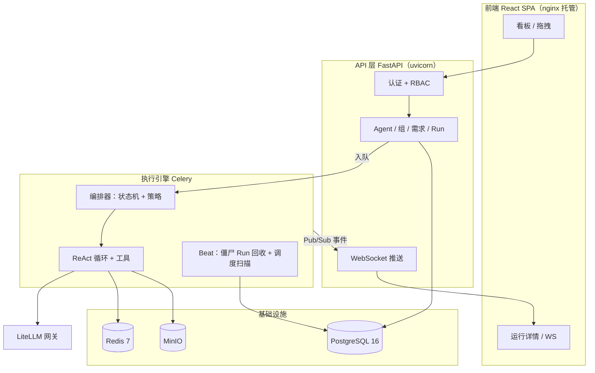

# Agent 工作台（Multi-Agent Workspace）

[](https://github.com/HangChi/multi-agent-workspace/actions/workflows/ci.yml)

> 拖拽式任务分发 + 多角色 Agent 执行的工作台系统。

把需求写成卡片：拖到**员工卡片**上是转交处理责任（对方在收件箱接收、退回或再转交），
拖到 **Agent/组**上是启动编排执行（状态机推进、逐步调用工具、全程 WebSocket 实时可见，
产出结果与制品）。适合部署在自己的服务器上，团队/个人自用。

---

## 核心能力

| 能力 | 说明 |
|---|---|
| **需求分派（007）** | 需求卡片可拖到员工卡片（或经人员选择器指定）：需求进入对方收件箱（`pending`），对方可接收 / 附原因退回 / 转交同事；全程经手链与站内通知留证 |
| **项目容器（008）** | 项目是需求的业务容器（单人归属）：建需求时可归类，看板按项目筛选；项目可改名（快照同步）/ 归档（只拦新建）/ 删除（需求保留、归属清空） |
| **拖拽分配** | 需求卡片用 dnd-kit 拖到 Agent 卡或组卡，落点弹窗选策略，`POST /requests/{id}/assign` 毫秒级受理，重活交给 Celery |
| **四种编排策略** | `direct` 单 Agent · `fan_out` 并行分发 · `pipeline` 顺序串联 · `router` 模型选成员，父子 Run 通过 `parent_run_id` 关联 |
| **ReAct 执行引擎** | 自研状态机 + 工具循环：LLM 推理 → 工具调用 → 结果回填 → 直到出最终答案；每步落库，可展开查看输入输出 |
| **实时反馈** | WebSocket 推送状态流转、分步日志、成本累计；支持心跳保活与终态自动关闭 |
| **成本熔断** | 单 Agent 成本上限 + 每用户月配额（分派给员工后仍记需求创建者），超限自动终止并给出可读原因 |
| **人工介入** | Agent 需要补充信息时进入 `needs_input`，用户回复后从断点继续 |
| **可观测** | 请求级 `request_id` 贯穿 API 与 Worker，生产环境结构化 JSON 日志 + 字段自动脱敏 |
| **安全** | 三角色 RBAC（admin/member/viewer）、资源归属校验（创建者或当前接收人）、敏感操作审计日志、生产环境弱密钥启动熔断 |

## 页面

| 路由 | 页面 | 内容 |
|---|---|---|
| `/` | 看板 | 需求按状态分列（含「待接收/已接收」）、拖拽源、员工卡与 Agent/组作为投放目标；「与我相关 / 我创建的」范围切换 + 按项目筛选（含未归属） |
| `/projects` | 项目管理 | 项目列表 / 新建 / 行内改名 / 归档切换 / 删除（需求保留、归属清空） |
| `/dashboard` | 仪表盘 | 运行中/排队数、今日完成与失败、7 日成功率与成本趋势 |
| `/agents` | Agent 管理 | 名称、描述、系统提示词、模型、温度、最大步数、工具集、成本上限；「从模板创建」一键预填，「克隆」复制配置，「存为模板」沉淀配置 |
| `/groups` | Agent 组 | 成员增删排序 + 默认路由策略，卡片上直接看编排顺序 |
| `/runs/:runId` | 运行详情 | 状态时间线、分步日志、成本、制品下载、取消/重试/回复 |
| `/settings` | 设置 | 低频配置的统一入口：通用（外观/账号/系统）、Agent 模板、定时调度、工具市场、管理后台 |
| `/settings/templates` | Agent 模板 | 内置模板（只读）+ 自己的模板：查看/编辑/删除/用模板创建（仅 member/admin） |
| `/settings/schedules` | 定时调度 | cron 周期规则 + 目标（Agent/组）+ 建单模板；触发历史与错过记录（仅 member/admin） |
| `/settings/marketplace` | 工具市场 | 外部 MCP 工具的发布列表与我的安装（003） |
| `/settings/admin` | 管理后台 | 审计日志（仅 admin，前端有角色守卫 + 后端 403 双保险） |

> 2026-11-18 起导航收敛：顶栏横栏只放看板、仪表盘、Agent、Agent 组四个业务入口，
> 模板/调度/工具市场/管理后台收进右上角「个人菜单」（头像下拉）里的设置分组。
> 旧地址（`/agent-templates`、`/schedules`、`/marketplace`、`/admin`）自动 301
> 到对应新地址，书签与外部链接不受影响。
>
> **快捷键**：`⌘K` / `Ctrl+K` 打开命令面板，可跳转页面、搜索 Agent / 组 / 需求，
> 以及执行「新建需求 / 新建 Agent / 切换主题」。顶栏的搜索框是同一个入口。

---

## 快速开始

### A. 全栈 Docker（推荐）

```bash
cp deploy/.env.example deploy/.env    # 生产必改 JWT_SECRET / INVITE_CODE / LLM_API_KEY
docker compose -p aw -f deploy/docker-compose.yml up -d --build
```

打开 <http://localhost:8080>。

> 项目名必须固定为 `aw`，容器名是 `aw-*`；不加 `-p aw` 会按目录名推导项目名导致容器名冲突。
> `.env` 必须放在 `deploy/` 下。

**没有真实 LLM 密钥也能跑通全链路**：改用 `--profile mock` 拉起内置 Mock 网关，并把
`deploy/.env` 的 `LLM_BASE_URL` 设为 `http://llm-gateway:4000`。

```bash
docker compose -p aw -f deploy/docker-compose.yml --profile mock up -d --build
```

### B. 本地开发（前后端热更新）

```bash
# 1. 只起基础设施
docker compose -p aw -f deploy/docker-compose.yml up -d postgres redis minio

# 2. 后端（Python 3.12+）
cd backend
python -m venv .venv && source .venv/bin/activate
pip install -e ".[dev]"
alembic upgrade head
uvicorn app.main:app --reload --port 8000

# 3. 前端（Node 22+）
cd frontend
npm install
npm run dev        # http://127.0.0.1:5173，/api 与 /ws 代理到 127.0.0.1:8000
```

### C. 创建第一个管理员

系统没有开放注册，必须凭邀请码。首个 admin 用脚本创建：

```bash
cd backend
python scripts/bootstrap.py \
  --email admin@example.com --password 'StrongPassw0rd!' \
  --invite-code ADMIN-CODE-123 --invite-role member --invite-max-uses 10
```

脚本会建/更新 admin 用户，并生成一个 `member` 角色的邀请码，供其他成员注册。API 文档见
<http://localhost:8000/docs>（FastAPI 自动生成 OpenAPI）。

**注入内置 Agent 模板**（幂等，可重复执行；模型取当前的 `LLM_MODEL`）：

```bash
cd backend
.venv/bin/python scripts/seed_agent_templates.py            # 实跑
.venv/bin/python scripts/seed_agent_templates.py --dry-run  # 只看会插入什么
```

换 LLM 端点后重跑一次即可把内置模板的模型改成新端点的模型；已存在的同名模板会被跳过。

---

## 架构



**分层取舍**：API 层只做校验 + 写入 + 入队 + 发事件，保证分配接口快速返回；重活全在 Worker。
Redis 同时承担队列、事件 Pub/Sub、分布式锁与 refresh token 存储。详见
[docs/architecture.md](docs/architecture.md)。

### 执行状态机

```
created → assigned → queued → running → completed
                                  ├──→ failed ──→ retry（手动，成本不清零）
                                  ├──→ retrying ──→ running（006 自动重试到点）
                                  │      └──→ failed（次数耗尽）
                                  ├──→ needs_input ──→ running
                                  └──→ cancelled / timeout
```

`completed` 是终态，不允许回退到 `running`；重复执行由 Redis 锁 + `run_id` 唯一约束拦住。

### 需求状态机（007）

```
created ──拖到员工──▶ pending ──员工接收──▶ accepted ──拖到 Agent/组──▶ running → 终态
   ▲                     │                    │
   └──────退回（原因必填）─┴────────────────────┘         （running 及以后拒收一切分派类操作）
```

`pending` 上再次拖人 = 转交（经手链记 `reassign`）；每次分派/转交/接收/退回都落
`request_dispatches` 不可变历史 + 站内通知 + 审计。成本与月配额恒记需求创建者
（不随经手人改记）。

### 编排策略

| 策略 | 语义 | 产物 |
|---|---|---|
| `direct` | 直接指定单个 Agent | 1 个 Run |
| `fan_out` | 组内成员并行执行同一需求 | 父 Run + N 个子 Run |
| `pipeline` | 按 `position` 顺序串联，前一段产出作为后一段输入 | 父 Run + N 个顺序子 Run（`runs.sequence` 排序） |
| `router` | LLM 按需求内容选最合适的成员 | 父 Run 自执行，决策写入 `result.routing`，路由成本计入 Run |

`pipeline` 只入队第一阶段，父 Run 不直接入队（否则会立刻"完成"）；某段失败会取消剩余段并把父 Run 标 failed。
`router` 解析或调用失败时全部降级到第一个成员，不会让需求卡死。

---

## 目录结构

```
backend/
  app/
    api/v1/         # 路由：auth/agents/agent-templates/groups/schedules/marketplace/external-tool-*/requests/runs/ws/stats/admin
    core/           # 配置、DB、JWT、token 存储、日志、审计
    models/         # SQLAlchemy 模型
    schemas/        # Pydantic v2 模型
    services/       # 业务逻辑：分配、配额、统计、调度、模板、沙箱、僵尸回收
    orchestrator/   # state_machine / strategies / runner / router
    executors/      # 工具执行器：calculate / read_url / web_search / run_python / run_shell / mcp
    tasks/          # Celery 任务与 Beat 调度
  alembic/          # 数据库迁移
  tests/            # unit + integration
  scripts/          # bootstrap 引导脚本 + seed_agent_templates 内置模板注入
frontend/
  src/
    api/            # axios 客户端 + 全部端点封装
    components/     # ui 基础组件 / board / agent / run / layout
    pages/          # 看板 / 仪表盘 / Agent / 模板 / 组 / 调度 / 市场 / 运行详情 / 管理
    stores/         # Zustand：auth / theme / board
    hooks/          # useAuth / useRequests / useRunSocket
deploy/             # docker-compose / Caddyfile / .env.example / mock-llm / verify
docs/               # 架构文档（入口见 docs/README.md）
specs/              # Spec Kit 规格（001–008，SDD + TDD 工作流）
```

---

## API 概览

所有接口前缀 `/api/v1`，除注册/登录外均需 `Authorization: Bearer <access_token>`。

```
POST   /auth/register                      邀请码注册（自动登录）
POST   /auth/login                         邮箱 + 密码 → access + refresh
POST   /auth/refresh                       refresh 轮换（带宽限期）
GET    /auth/me                            当前用户

GET|POST      /agents                      列表（?status=&q=）/ 创建
PATCH|DELETE  /agents/{id}                 编辑 / 删除（被组引用时 409，只能归档）
POST          /agents/{id}/archive         归档
POST          /agents/from-template/{tid}  从模板创建（模板值打底 + 请求体覆盖）
POST          /agents/{id}/clone           一键克隆（拷配置，不带运行历史与授权）
POST          /agents/{id}/save-as-template  把 Agent 快照成模板

GET           /agent-templates             模板列表（内置 + 自己的，?scope=&q=）
GET           /agent-templates/{id}        模板详情
PATCH|DELETE  /agent-templates/{id}        编辑 / 删除自己的（内置 403）

GET           /tools                       工具目录（启用态由 002 治理）

GET|POST      /schedules                   调度规则列表 / 创建
POST          /schedules/preview           周期表达式预览（下次触发时刻）
GET           /schedules/{id}              规则详情
PATCH|DELETE  /schedules/{id}              编辑 / 删除
GET           /schedules/{id}/triggers     触发历史（?result= 过滤）

GET           /marketplace/tools            外部工具市场列表（?category=&q=）
GET           /marketplace/tools/{lid}     市场工具详情
POST          /marketplace/tools/{lid}/install   安装
POST          /marketplace/tools/{lid}/pause     暂停
POST          /marketplace/tools/{lid}/resume    恢复
POST          /marketplace/tools/{lid}/revoke    撤销
GET           /marketplace/installations   我的安装
POST          /marketplace/installations/{iid}/upgrade   升级安装

GET|POST      /groups                      Agent 组
PATCH|DELETE  /groups/{id}
POST          /groups/{id}/members         添加成员
PATCH         /groups/{id}/members         批量改顺序
DELETE        /groups/{id}/members/{aid}   移除成员

POST|GET      /external-tool-servers       外部 MCP 服务器注册 / 列表
GET|PATCH     /external-tool-servers/{id}  详情 / 编辑
POST          /external-tool-servers/{id}/validate          连通性校验
POST          /external-tool-servers/{id}/credentials/rotate  凭证轮换
POST          /external-tool-servers/{id}/tools/{vid}/approve  审批工具版本
POST          /external-tool-servers/{id}/tools/{vid}/reject   拒绝工具版本
POST|GET      /agents/{id}/external-tool-grants              授权 / 列表
DELETE        /agents/{id}/external-tool-grants/{gid}        撤销授权
GET|POST      /agents/{id}/egress-rules                     出站规则列表 / 新增
DELETE        /agents/{id}/egress-rules/{rid}               删除出站规则
GET           /external-tools/observability                 调用观测（管理员）

GET|POST      /admin/egress-blacklist                       全局黑名单（仅 admin）
DELETE        /admin/egress-blacklist/{domain}              移除黑名单条目
GET           /admin/egress-accesses                        出站访问查询（仅 admin）

GET|POST      /requests                    看板列表（?scope=relevant|mine&status=&q=&priority=&page=）/ 创建
GET           /requests/{id}               详情（含分派指针 assignee_* 与经手链 dispatch_history）
POST          /requests/{id}/attachments   附件上传（预签名）
POST          /requests/{id}/assign        拖拽落点：{assignee_type: user|agent|group, assignee_id, strategy?, note?}
                                             拖 user = 仅转交责任（不建 Run）；拖 agent/group = 建 Run 执行
PATCH         /requests/{id}               008：编辑需求（含 project_id 时仅创建者可改）
POST          /requests/{id}/accept        007：接收分派来的需求（pending → accepted）
POST          /requests/{id}/reject        007：退回（pending|accepted → created，reason 必填 1..2000）

GET           /projects                   008：我的项目（?scope=mine|relevant）+ 每项需求计数
POST          /projects                   008：建项目（同用户名下唯一，含归档也占名字）
PATCH         /projects/{id}              008：改名（同步需求快照）/ 归档 / 恢复
DELETE        /projects/{id}              008：删除（需求保留、归属清空；审计记 request_count）
GET           /users/options               007：在职用户最小投影（分派选人；viewer 403）
GET           /notifications               007：我的通知（?unread_only=）
GET           /notifications/unread-count  007：未读数（铃铛轮询目标，≤30s）
POST          /notifications/read          007：批量已读（ids 缺省 = 全部）

GET           /runs/{id}                   详情（状态、步骤、成本、错误）
POST          /runs/{id}/cancel            取消
POST          /runs/{id}/retry             重试
POST          /runs/{id}/reply             补充信息后继续
GET           /runs/{id}/artifacts/{aid}   制品下载（302 → 预签名 URL）

WS            /ws/runs/{id}?token=...      实时状态 + 分步日志 + 成本
WS            /ws/requests/{id}?token=...   007：分派类状态变更（仅创建者/当前接收人可订阅）
GET           /stats/overview              仪表盘聚合（运行中/排队/今日完成失败/7 日成功率与成本）
GET           /audit-logs                  审计日志（仅 admin，支持分页与筛选）
GET           /health, /health/ready       存活 / 就绪探针
```

**认证细节**：access token 默认 30 分钟，refresh 一次性消费（真轮换，旧 token 立即失效）；
`REFRESH_GRACE_SECONDS` 给多标签页并发刷新留宽限期，避免互相踢下线。

> 以上是概览。完整的请求/响应 schema、错误码与边界语义在各特性的
> `specs/NNN-*/contracts/api.md`（001–008 八份），运行时以 `/docs` 的 OpenAPI 为准。

### 内置工具

Agent 可挂载的工具由执行器注册表提供，当前实现 5 个：

| 工具 | 说明 |
|---|---|
| `web_search` | 联网搜索，需配置 `SEARCH_API_URL` / `SEARCH_API_KEY`，未配置时返回可读降级结果 |
| `read_url` | 抓取网页正文，带 SSRF 防护：私网 IP 拦截、重定向逐跳校验、2MB 上限 |
| `calculate` | 四则运算，AST 白名单求值（禁 `eval`，限制幂指数防计算爆炸） |
| `run_python` | Docker 一次性容器内跑 Python：超时、取消、资源限制、输出截断、制品回收 |
| `run_shell` | 同上，跑 shell 命令；两者共用沙箱边界（002） |

另有**外部 MCP 工具**（003）：由管理员注册服务器、审批工具版本，成员按 Agent 授权后使用，
与内置工具走同一条执行循环，但凭证在服务端保管、调用全程留证。

---

## 配置

全部配置走环境变量，`deploy/.env.example` 是完整清单。关键项：

| 变量 | 默认 | 说明 |
|---|---|---|
| `APP_ENV` | `development` | 设为 `production` 时启动强校验 `JWT_SECRET`(≥32) 与 `INVITE_CODE`(≥12)，弱密钥直接拒绝启动 |
| `DATABASE_URL` | `postgresql+asyncpg://...` | PostgreSQL 连接串 |
| `REDIS_URL` / `CELERY_BROKER_URL` / `CELERY_RESULT_BACKEND` | `redis://localhost:6379/{0,1,2}` | 缓存/队列/结果后端分库 |
| `JWT_SECRET` | — | 生产必改 |
| `JWT_ACCESS_TTL_MINUTES` | `30` | access token 时长 |
| `JWT_REFRESH_TTL_DAYS` | `7` | refresh token 时长 |
| `REFRESH_GRACE_SECONDS` | `30` | refresh 宽限期，`0` = 严格一次性 |
| `INVITE_CODE` | — | 首个管理员邀请码 |
| `LLM_API_KEY` / `LLM_MODEL` / `LLM_BASE_URL` | `gpt-4o-mini` / OpenAI | 走 LiteLLM 网关，任意 OpenAI 兼容端点 |
| `MINIO_*` | `localhost:9000` | 附件与制品存储（S3 兼容） |
| `MONTHLY_QUOTA_CENTS` | `1000000` | 每用户月成本上限（分），用尽后新分配返回 429 |
| `CORS_ORIGINS` | `http://localhost:5173` | 本地开发前端地址 |
| `RUN_MAX_ATTEMPTS` | `3` | 总尝试次数（含首次）；设为 1 等于关闭自动重试 |
| `RUN_RETRY_BASE_SECONDS` | `2` | 重试退避基准（秒，full jitter 后实际值在 `[0, 基准]`） |
| `RUN_RETRY_CAP_SECONDS` | `60` | 退避封顶（秒） |

---

## 测试与质量门禁

当前套件规模：后端 **1403 个用例**（unit + integration，真实 PostgreSQL 16）、
前端 **129 例 / 23 文件**。CI（[.github/workflows/ci.yml](.github/workflows/ci.yml)）在每次
push / PR 跑以下流水线：

- **后端**：`ruff check` → `ruff format --check` → `mypy app` → `alembic upgrade head`
  （空库可达性）→ `pytest --cov`（带覆盖率门禁）
  （Postgres 16 + Redis 7 service，MinIO 用 `docker run` 起，因为 service 不允许自定义启动命令）
- **前端**：`eslint` → `prettier --check` → `tsc --noEmit` → `vitest run` → `vite build`
  （并断言 CSS 产物 > 5KB，专防 PostCSS/Tailwind 配置丢失导致整站零样式回归）
- **镜像**：`docker build backend` → 起容器 → 容器内自请求 `/openapi.json` 探活 → 断言非 root

三道门禁解决的是同一类问题：**代码没问题、但交付物坏了**。

- `ruff format --check` / `prettier --check`：没有它，格式会随各自编辑器的保存钩子漂移，
  最终每次 diff 都夹带无关改动。`ruff check` 只看语义，不管排版，两者必须都有。
- 覆盖率门禁（阈值见 `backend/pytest.ini` 的 `fail_under`）：没有它，删测试不会有任何反馈，
  覆盖率只会单向下降。
- 镜像构建 + 启动探活：没有它，`Dockerfile` 可以长期失修而 CI 全绿 ——
  依赖清单改了忘同步 lock、基础镜像 tag 消失，都要拖到部署当天才发现。

本地等价命令：

```bash
# 后端（测试库需先建：createdb agent_workbench_test）
cd backend
DATABASE_URL="postgresql+asyncpg://aw:<密码>@127.0.0.1:5432/agent_workbench_test" python -m pytest -q
python -m ruff check app tests && python -m ruff format --check . && python -m mypy app

# 前端
cd frontend && npm run lint && npm run format:check && npm run typecheck && npm test && npm run build

# 镜像（可选，验证 Dockerfile 仍可用）
docker build -t aw-backend:local backend
```

> pytest 必须显式传 `DATABASE_URL` 指向 `_test` 库，否则 conftest 会回落到代码内默认口令。
>
> 格式化修复用 `ruff format .` 与 `npm run format`；只用 `--check` 看是否干净。

### 真实栈端到端验证

`deploy/verify/` 下的脚本跑在真实容器栈上，与进程内集成测试互补：

```bash
backend/.venv/bin/python deploy/verify/s1_s4_scenarios.py --base http://localhost:8080
backend/.venv/bin/python deploy/verify/s5_scenarios.py    --base http://localhost:8080 --invite <INVITE>
backend/.venv/bin/python deploy/verify/strategy_scenarios.py --base http://localhost:8080 --invite <INVITE>
backend/.venv/bin/python deploy/verify/s6_agent_templates.py --base http://localhost:8080 --invite <INVITE>
backend/.venv/bin/python deploy/verify/s8_request_dispatch.py --base http://localhost:8080 --invite <INVITE>
node deploy/verify/ui_s4_s5.cjs    # 真实浏览器：拖拽 + 实时日志（需 playwright）
```

各脚本覆盖的场景与实测记录在对应特性的 `quickstart.md` 里：
[s1–s4](specs/001-core-workflow/quickstart.md) ·
[s5 域名/出网](specs/002-sandboxed-tools/quickstart.md) ·
[003 外部工具](specs/003-mcp-tool-market/quickstart.md) ·
[005 模板与克隆](specs/005-agent-templates/quickstart.md) ·
[007 分派收件箱](specs/007-request-dispatch/quickstart.md) ·
[008 项目容器](specs/008-project-entity/quickstart.md)。

已记录的关键实测数据：分配受理 12ms、WS 推送滞后 0.25s 内、20 并发全量完成 1.71s、
失败重试成功率 5/5；压测 100 并发 818 req/s、200 并发 0 错误（P95 受 2 vCPU 开发机限制）。

---

## 部署

单机 Docker Compose 即可。服务清单、生产注意、HTTPS 入口、日志排查、数据备份与升级流程见
[deploy/README.md](deploy/README.md)，要点：

- 宿主只映射 `frontend` 端口，`api` 完全不暴露；postgres/redis/minio 绑 `127.0.0.1`
- `migrate` 服务每次 `up` 先跑 `alembic upgrade head`，其余服务等它就绪
- 每个服务都设了 CPU/内存上限与日志轮转（10MB × 3）
- 需要公网 HTTPS 时用 `deploy/Caddyfile`（自动证书 + WS 透传），默认部署不需要

---

## 开发流程

本项目按 **Spec Kit** 的 SDD + TDD 工作流推进，规格先行：每个特性一份
`specs/NNN-<name>/`，内含 `spec.md`（WHAT/WHY + 用户故事 + FR/SC）、`plan.md`、
`research.md`（关键决策与「为什么更简单的做法不行」）、`data-model.md`、
`contracts/api.md`、`checklists/requirements.md`、`tasks.md`（实现后逐条勾选 +
实测记录）、`quickstart.md`（真实栈验收）。

| 特性 | 内容 | 状态 |
|---|---|---|
| [001-core-workflow](specs/001-core-workflow/spec.md) | 拖拽分配 + 四种编排 + ReAct 引擎 + 实时反馈 | ✅ 84/84 |
| [002-sandboxed-tools](specs/002-sandboxed-tools/spec.md) | 代码沙箱（Docker 一次性容器）+ 出网治理 + 工具目录 | ✅ 76/76 |
| [003-mcp-tool-market](specs/003-mcp-tool-market/spec.md) | 外部 MCP 工具：注册/审批/授权/调用留证 | ✅ 65/65 |
| [004-scheduled-requests](specs/004-scheduled-requests/spec.md) | 定时调度：cron 规则 → 自动建单分配 + 错过不补跑 | ✅ 65/65 |
| [005-agent-templates](specs/005-agent-templates/spec.md) | Agent 模板 + 一键克隆 + 另存为模板 + 内置模板 | ✅ 39/39 |
| [007-request-dispatch](specs/007-request-dispatch/spec.md) | 需求分派给员工 + 收件箱 + 站内通知 + 经手链 | ✅ 41/41（s8 真实栈 7/7） |
| [008-project-entity](specs/008-project-entity/spec.md) | 项目容器：需求归类 + 看板按项目筛选 + 项目 CRUD | ✅ 30/30（s9 真实栈 5/5） |

分支约定：特性开发走 `feat/<name>`，每个 Phase 一次提交，完成后 fast-forward 合并回
`master` 并删除特性分支。宪法见 [.specify/memory/constitution.md](.specify/memory/constitution.md)。

---

## 已知限制

- 需求分派与收件箱（007）：通知**仅站内**（铃铛轮询 ≤30s 刷新未读数，无邮件/Webhook 通道）；
  「与我相关」是看板默认范围（只扩大不缩小）；跨用户错误码并存——既有需求端点 403、
  007 新分派端点与 agent/组 404（历史差异，统一收敛未做）。
- 项目容器（008）：项目为**单人归属**（无成员/共享，组织形态后置 P2）；
  **需求间依赖/DAG 不在本特性**（用户 2026-11-18 确认留后续，008 spec FR-011 钉住）；
  删除项目是物理删除 + 需求归属清空（迁移 downgrade 同样会丢项目实体，已记入回滚面）。
- `Agent.tools` 已按工具目录过滤实际注入 LLM 的工具集；未授权目录工具会返回 `denied` 结构并写入审计日志。
- `run_python` / `run_shell` 已接入 Docker 一次性容器，支持超时、取消、资源限制、输出截断与制品回收；原生 Linux 的 iptables/nftables 出网验收已在 CI 的原生 VM 上通过（`iptables-save` / `ip6tables-save` / `nft` 残留全 0，域名矩阵 18/18）。唯一例外是 `public HTTPS with DNS attribution`：它依赖宿主公网，按非门禁用例运行并在产物里留证。
- 出网规则管理、Agent 限制模式和访问查询端点已接入；TLS 解密、URL 路径/请求体级记录仍不在范围内。
- 定时调度已实现：`/schedules` 页面可建规则的周期（cron）、目标（Agent 或组）与建单模板，Celery Beat 每分钟扫描到期的规则自动建单并分配执行。错过的计划时刻**不补跑**，合并记一条 `missed` 并注明次数。周期表达式的「日期」与「星期」同时限定时按**交集**求值（`0 9 1 * 1` 只在既是 1 号又是周一那天触发），页面上已明示。beat 的资源限额按实测定（1.0 CPU / 512MB，峰值 268 MiB、无 `max` 事件、CPU 节流 12%）。
- 运行自动重试已实现（`006`）：仅对**瞬时类失败**（网关 5xx、连接失败、超时、限流）自动重试，默认「首次 + 2 次重试」共 3 次尝试，指数退避 2s→4s 带 full jitter、60s 封顶；业务类失败（配额/成本/步数/超时/取消/策略拒绝）与未知异常一律不重试。重试等待中以 `retrying` 中间态呈现，僵尸回收不会误杀它。**成本跨重试累计**（手动重试同口径）：重试花的 token 照计入配额与熔断，不再因重试重置——这让看板数字对得上真实支出，也堵住了「每次各花 490 分、上限 500 分」绕过熔断的洞。重复执行由 Redis 锁 + 状态校验双重防线拦截。
- Agent 模板与一键克隆已实现（`005`）：模板是**个人私有**的配置快照库，从模板创建、一键克隆、另存为模板三条路径；内置模板由 `scripts/seed_agent_templates.py` 幂等注入（模型跟随 `LLM_MODEL`）。**不含**跨用户共享/模板市场、版本历史、导入导出与使用统计。
- 外部 MCP 工具已实现（`003`，65/65 任务）：仅支持 Streamable HTTP 传输，stdio 传输与工具市场之外的自定义 UI 不在范围内。
- **指标与告警**：`/metrics`（Prometheus 文本格式，零依赖实现）已接入，覆盖 HTTP/WS/LLM/沙箱/队列深度/成本；
  Celery 进程通过 Redis 快照合并进同一端点。`deploy/observability/` 有抓取配置与 8 条告警规则，
  但**阈值尚未在真实流量下验证**（这也是 003 发布状态里未闭环的那一项）。没有 Grafana 面板。
- **备份**：`deploy/backup/backup.sh`（pg_dump + 对象目录 + manifest）与 `restore-drill.sh`
  （还原到临时库并断言迁移版本/表数）已就绪，cron 写法见该目录 README；**恢复演练只在开发机跑过**。
- **部署**：`deploy/deploy.sh`（迁移 → 换容器 → 健康门禁 → 失败回滚）+ CI 手动触发的 `deploy` job；
  真正的生产环境部署 smoke 仍需有主机与域名时执行。
- **尚未实现**：Sentry 异常上报、Grafana 面板、PITR（时间点恢复）。
- **压力验证**：`deploy/verify/load_test.py` 实测 100 并发 818 req/s、200 并发 0 错误，
  但 P95 在 100 并发下突破 500ms（2 vCPU 开发机），详见 `docs/load-test-2026-11-17.md`。
- 前端单测覆盖页面、store 与组件（20 文件 / 107 例）；真实浏览器的端到端验证依靠人工或按需脚本，仓库内没有 Playwright e2e。
- 未指定开源许可证；仓库为私有自用。

---

## 文档

| 文档 | 内容 |
|---|---|
| [docs/README.md](docs/README.md) | **文档索引**：全部文档的位置与用途 |
| [docs/architecture.md](docs/architecture.md) | 完整设计文档：领域模型、技术选型理由、执行引擎、安全设计、数据表 |
| [deploy/README.md](deploy/README.md) | 部署、生产注意、日志排查、备份与升级 |
| [docs/llm-pricing.md](docs/llm-pricing.md) | LLM 单价表口径（成本核算与熔断的基准） |
| [docs/load-test-2026-11-17.md](docs/load-test-2026-11-17.md) | 100/200 并发压测记录 |
| [docs/code-audit-2026-11-17.md](docs/code-audit-2026-11-17.md) | 2026-11-17 全量代码审查报告（含修复进度） |
| [specs/](specs/) | 001–008 八个特性的规格四件套 + 任务清单 + 实测记录 |
| [.specify/memory/constitution.md](.specify/memory/constitution.md) | 项目宪法（SDD + TDD、质量门禁、安全边界） |
